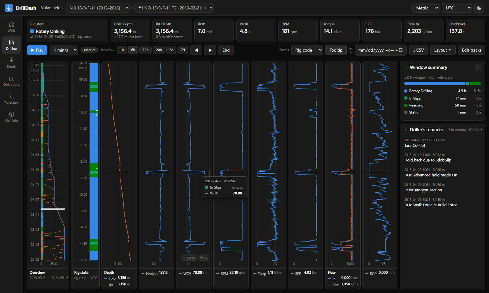
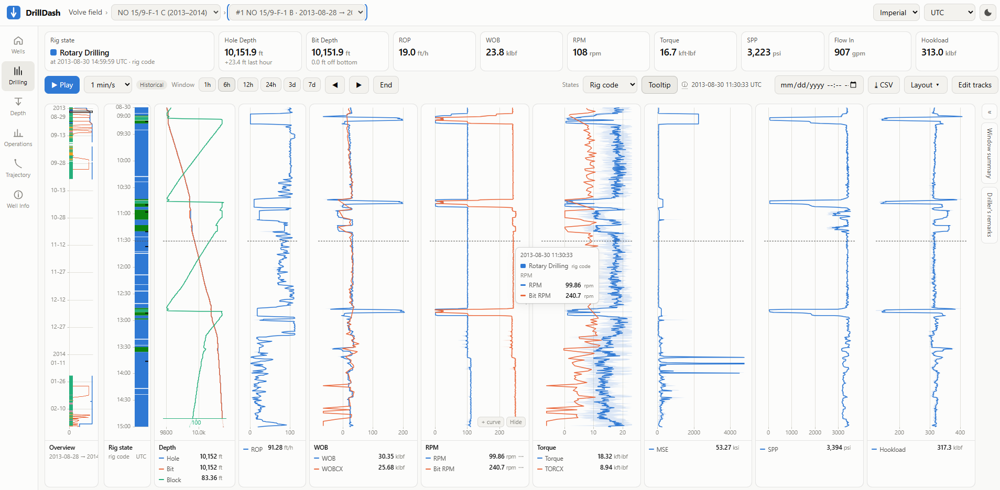
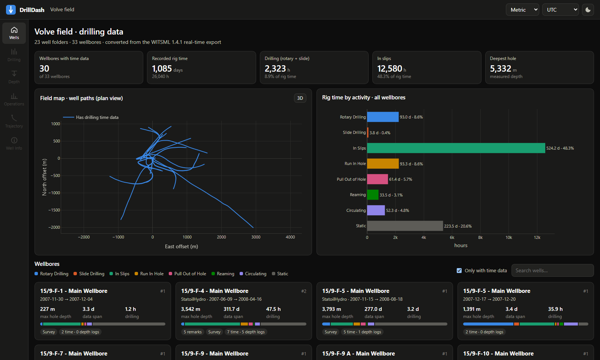
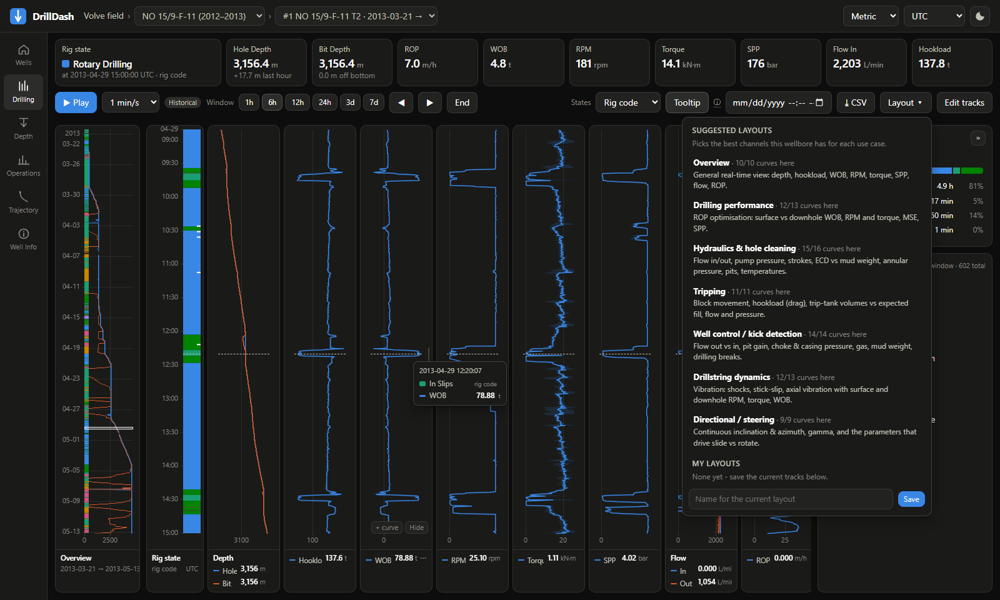
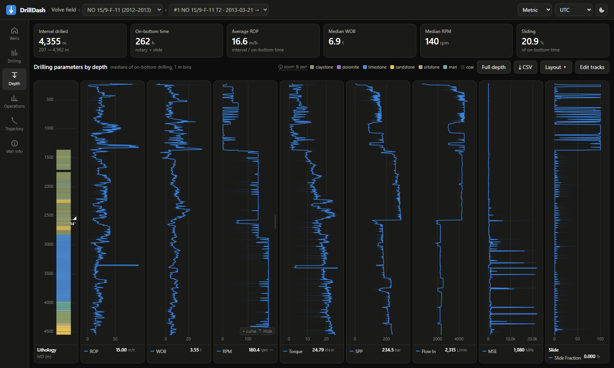
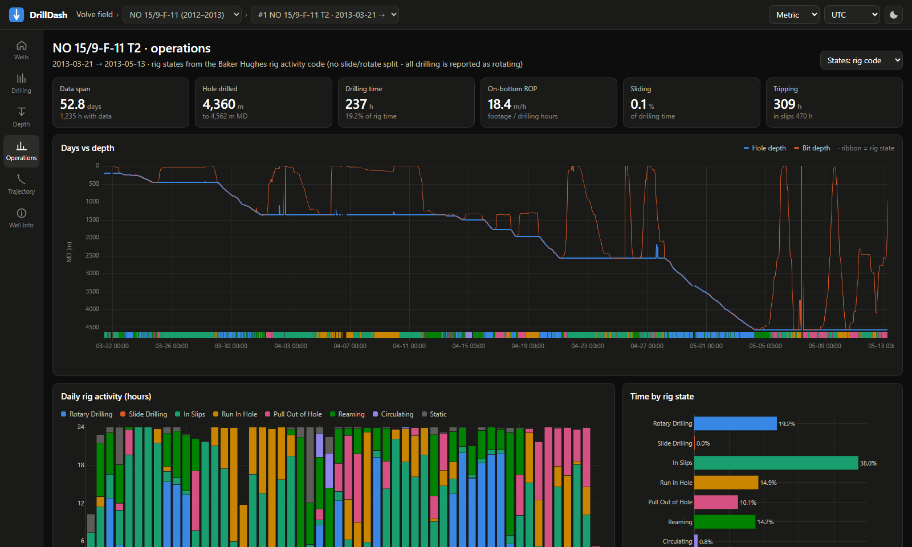
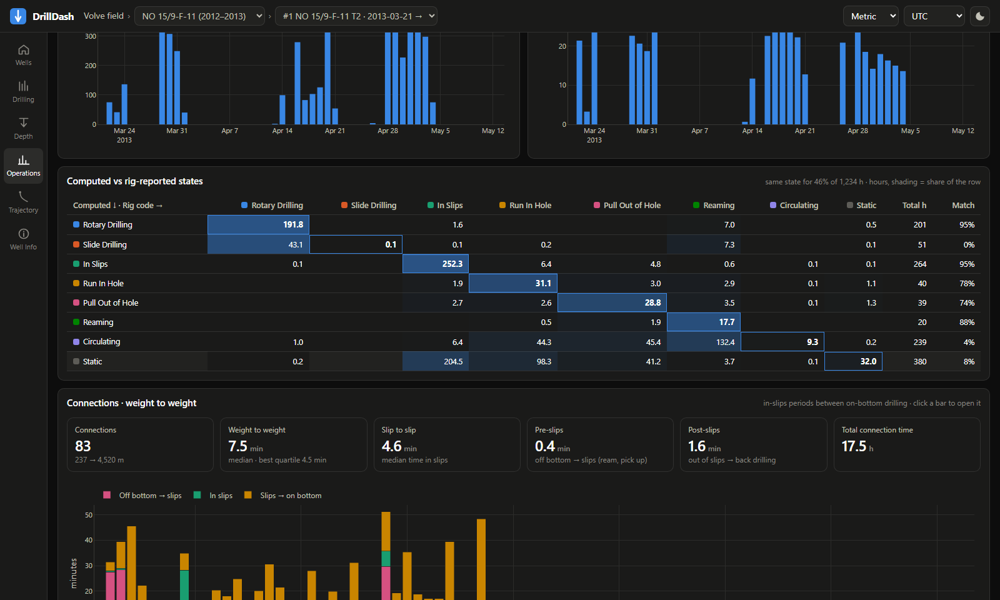
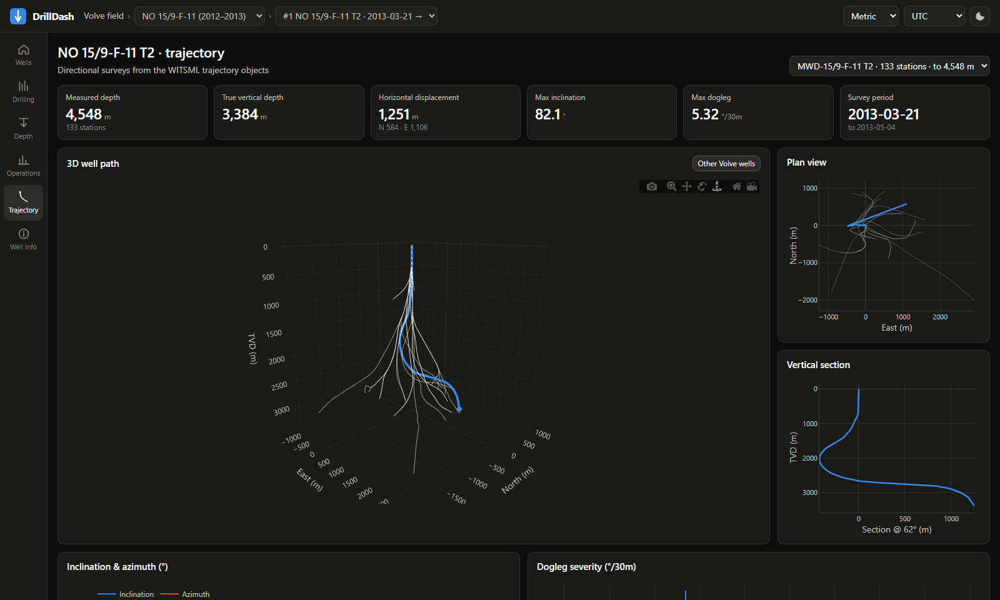

# DrillDash

A real-time drilling dashboard for WITSML 1.4.1 data, built and tested on the public **Equinor Volve** field dataset (23 well folders, 33 wellbores, ~19 GB of WITSML XML).

It converts the raw XML export into a fast columnar store once, then serves an interactive web app with log-style time and depth tracks, rig-activity classification, connection times, trajectories, BHA and casing data, and a replay mode that plays historical data back as if it were streaming from the rig.




## Features

* **Time-based drilling view**: vertical log tracks synced on one time axis; box zoom in time and value; a whole-well overview column; rig-state column; window summary and driller's remarks; hover tooltip; **replay** at 1× to 2 h/s.
* **Any channel, any track**: search all ~700 channels per wellbore; several curves per track, each curve on a shared or independent scale; resizable, hideable, drag-and-drop tracks.
* **Suggested layouts** for drilling performance, hydraulics, tripping, well control, drillstring dynamics, directional, and formation evaluation. Each picks the best channels the wellbore has, across Baker Hughes and SLB/Geoservices naming.
* **Rig states**: rule-based classification from surface sensors, or the rig's own Baker Hughes `RigActivityCode`, with an agreement matrix between the two.
* **Operations analytics**: days vs depth, daily activity breakdown, footage and ROP per day, weight-to-weight connection times.
* **Depth view**: on-bottom drilling parameters by depth, LWD logs, mud-log lithology and casing shoes.
* **Trajectory**: 3D well path among all field wells, plan and section views, dogleg severity, survey table.
* Metric / imperial units, UTC / well-local time, dark / light theme, CSV export at full resolution.

| | |
|---|---|
|  |  |
|  |  |
|  |  |

## Getting the data

The app needs a **store**: the converted, analysis-ready version of the Volve WITSML data. There are three ways to get one:

| Option | What you get | How |
|---|---|---|
| **Demo** (included) | 2 wellbores: NA-NA F-5 (SLB, 2007) and F-1 C #3 (Baker Hughes, 2013, with rig code, remarks, mud log, BHA) | nothing to do - used automatically when there is no `store/` |
| **Prebuilt store** (recommended) | all 30 wellbores with drilling data, ready to use | download from [**Releases**](../../releases) and unzip into this folder (below) |
| **Build it yourself** | same as the prebuilt store, from the raw XML | download the Volve dataset and run `ingest.py` (~5 min) |

**Prebuilt store.** The release has three zips; any subset works, and the dashboard shows the wells you have:

| File | Wells | Size |
|---|---|---|
| `store-bakerhughes-1.zip` | F-1 C, F-11 (Baker Hughes / Statoil, 2013-2016) | 1.4 GB |
| `store-bakerhughes-2.zip` | F-15 and the other Statoil-NO wells | 0.7 GB |
| `store-slb-geoservices.zip` | 14 SLB / Geoservices / StatoilHydro wells (2007-2009) | 0.7 GB |

Unzip them into the repository folder so you get `DrillDash/store/<well>/...` (each zip already contains the `store/` folder and `catalog.json`; let files overwrite). Checksums are in `SHA256SUMS.txt`.

**Build it yourself.** Download the Volve dataset from Equinor (<https://www.equinor.com/energy/volve-data-sharing>) and take the folder **`WITSML Realtime drilling data`**. DrillDash finds it in the first of these places that exists, or pass `--src`:

1. the path in the environment variable `DRILLDASH_SRC`
2. `./data/WITSML Realtime drilling data` (inside this repository; `data/` is git-ignored)
3. `../WITSML Realtime drilling data` (next to this repository)

The launchers run `ingest.py --auto`, which builds the store on the first run when the data is present and otherwise does nothing.

## Quick start

Requirements: Python 3.10+ with `pandas`, `numpy`, `pyarrow` and `flask` (Anaconda already has all of them):

```
pip install -r requirements.txt
```

* **Windows:** double-click `run_dashboard.bat`
* **macOS / Linux:** `./run_dashboard.sh`

Either script builds the store on the first run if the Volve data is present (about 5 minutes, ~2.7 GB in `store/`), then opens <http://localhost:8050>. Without data or a downloaded store, it shows the demo. To run the steps yourself:

```
python ingest.py          # WITSML XML -> store/   (once, or after new data arrives)
python server.py          # serves http://localhost:8050
```

The charting libraries are bundled in `static/vendor`, so the app works offline.

## Project layout

```
ingest.py              WITSML XML -> Parquet/JSON store: unit conversion, channel mapping, rig states, connections
server.py              Flask API: windowed + binned series, snapshots, objects, CSV export; serves the app
static/index.html      single-page app shell
static/js/             app code (no build step): pages/, track panel, charts, layouts, units
static/css/app.css     styles (dark and light themes)
static/vendor/         uPlot and Plotly (bundled)
run_dashboard.bat/.sh  one-click launchers
demo/store/            small sample store (2 wellbores) so the app runs right after cloning
tools/package_store.py builds demo/store and the release zips from a full store
```

## Pages

| Page | What it shows |
|---|---|
| **Wells** | Field summary, a map of every well path (plan view or 3D), rig time by activity, and a card for each wellbore |
| **Drilling** | KPI tiles; a vertical **overview column** of the whole wellbore on the far left (hole/bit depth plus a rig-state ribbon); vertical time tracks (depth, hookload, WOB, RPM, torque, SPP, flow, ROP) with a rig-state column; a window summary and driller's remarks in a side panel that can be collapsed. **Play** replays the historical data as if it were streaming live, at 1× up to 2 h/s. **Export CSV** downloads every curve in the window at full resolution. |
| **Depth** | Median on-bottom drilling parameters in 1 m hole-depth bins (ROP, WOB, RPM, torque, SPP, flow, MSE, slide fraction), plus the mud-log lithology column and casing shoes. Raw depth logs (gamma, resistivity, …) can be added as tracks. |
| **Operations** | Days vs depth, daily rig activity (hours per state), time by state, footage and ROP per day, **connection times** (weight-to-weight broken into pick-up, in slips and back to bottom; click a bar to open that connection), and a daily report table. Click a row to open that day. |
| **Trajectory** | 3D well path among the other Volve wells, plan view, vertical section, inclination/azimuth, dogleg severity, and the survey table |
| **Well Info** | Well and wellbore metadata, rig, casing/hole sections, BHA runs with their components, a searchable list of driller's remarks, and an inventory of every log and channel. **Plot** sends a channel to the Drilling or Depth tracks. |

The top bar switches between Metric (m, t, bar, L/min, sg) and Imperial (ft, klbf, psi, gpm, ppg), UTC and well-local time, and dark and light themes.

### Working with tracks (Drilling and Depth pages)

| Action | Result |
|---|---|
| Drag up/down on a track | zoom time (or depth) for all tracks |
| Drag left/right on a track | zoom that track's value scale |
| Drag diagonally | zoom both |
| Scroll / Ctrl+scroll / Shift+scroll | pan / zoom time / zoom values |
| Double-click a track | reset its value zoom; a second double-click resets the window |
| Overview column | drag the highlighted band to move the window, drag elsewhere to draw a new one, scroll to widen or narrow it, click to jump |
| **+ curve** (bottom-right of a track, shown while you hover it) | add any channel to that track (up to 6). Related channels are suggested first, e.g. CoPilot downhole WOB `WOBCX` for the WOB track |
| **Edit tracks** | drag the ⠿ handle to reorder tracks (top of the list = leftmost track); the handle also responds to ↑ / ↓ |
| Click a curve name in the legend | switch that curve off / on (it is struck through and leaves the auto-scale) |
| **⋯** next to a curve, or right-click its name | **Own scale** (an independent scale that fills the track width, e.g. block height next to hole/bit depth; it gets its own axis strip, in the curve's colour, drawn inside the bottom of that chart so no other track loses height), a fixed min/max scale, or remove the curve |
| **Hide** (bottom-right of a track, shown while you hover it) | fold the track into a thin strip; click the strip to show it again. Edit tracks also has Show/Hide per track |
| Drag a column's right edge | make that track, the rig-state column or the overview wider or narrower. The width is saved; double-click the edge to reset it |
| Hover a track | a tooltip next to the pointer shows the time (or MD), the rig state (or lithology) and that track's values. Switch it off with **Tooltip** in the toolbar |
| Edit tracks / + curve | **All channels** lists every channel of every log; typing searches all of them by mnemonic, description or log name, e.g. "block pos" finds `BLOCKCOMP` |

Curve names, live values and the value scale sit at the bottom of each track. Curves with the same unit share a scale. A curve in a different unit gets its own scale, drawn as a small axis strip in the curve's colour inside the bottom of the chart. Track layouts are saved in the browser and shared by all wells. A curve whose log doesn't exist in the current wellbore shows `n/a`.

### Suggested layouts

**Layout ▾** (Drilling and Depth toolbars) applies a ready-made track set for a use case:

| Drilling page | What it shows |
|---|---|
| Overview | depth, hookload, WOB, RPM, torque, SPP, flow, ROP |
| Drilling performance | ROP, surface + downhole WOB / RPM / torque, MSE, SPP, hookload |
| Hydraulics & hole cleaning | flow in/out, SPP, strokes, mud weight in/out vs ECD, annular pressure, pits, temperatures |
| Tripping | block, hookload, trip-tank volumes vs expected fill, flow, SPP, RPM |
| Well control / kick detection | flow out vs in (incl. flow-out %), pit gain, choke & casing pressure, gas, mud weight, ROP (drilling breaks) |
| Drillstring dynamics | stick-slip, shocks / lateral and axial vibration with surface + downhole RPM, torque, WOB |
| Directional / steering | continuous inclination & azimuth, gamma, ROP, WOB, RPM, torque |

The Depth page has Drilling performance, Formation evaluation (gamma, resistivity, density, neutron, ROP, ECD), Hydraulics, and Drillstring dynamics.

Each layout lists candidate channels in priority order across vendors, for example downhole WOB `WOBCX`/`WOBAX`/`DWOB`, ECD `ACTECDX`/`ECD_ARC_RT`/`ECDBIT`, and vibration `SHKPK_RT`/`SEVXYDX`. It uses whichever one the current wellbore has. The menu shows how many of a layout's curves exist here. While a suggested layout is active it re-adapts when you switch wells; as soon as you change it, it becomes your own layout. **My layouts** saves the current tracks under a name.

### Rig state source

The **States** selector on the Drilling and Operations pages switches between:

* **Rig code** (default where available): Baker Hughes `RigActivityCode` as recorded on the rig. It exists for the 2013–2016 Baker Hughes wellbores. The code is `100·rotating + 10·circulating + activity`, where activity is 1 drilling, 2 reaming, 3 off bottom, 4 in slips, 5 connection, 6/7 tripping in/out, 8 trip in slips, 9 shut in, and it is mapped onto the same 8 states. The rig code never separates sliding from rotary drilling.
* **Computed**: DrillDash's own classifier (below). It's the only option for the 2007–2009 SLB/Geoservices wellbores. Their `ACTC` "Rig Mode" channel has no published code table, so it isn't interpreted, but you can still plot it as a curve.

The Operations page shows a **computed vs rig code** hours matrix. The two agree on rotary drilling, in slips and tripping. They mainly differ where the rig code stays "tripping" or "in slips" through pauses (computed: Static), and where it calls slow circulating while tripping "reaming" or "tripping" (computed: Circulating). Connection times always use the computed states.

## How the data is processed (`ingest.py`)

* Every log object (folder `log/<k>/<n>/<sub>/*.xml`) is parsed and its chunks are merged. Objects are grouped by log name and index type, read from `<indexType>` because the `1`/`2` folder numbers aren't consistent. All values are converted to SI. The result is saved as `store/<well>/<wellbore>/logs/*.parquet`.
* **Standard drilling channels** are mapped from vendor mnemonics: Baker Hughes `GenTime` (`HKLD_AVG`, `WOB_AVG`, `SURF_RPM`, …) and SLB/Geoservices section time logs (`HKLD`, `SWOB`, `RPM`, `GS_*`, …). When a log interleaves both SLB and Geoservices rows, one vendor family is used per log. Time logs are combined by priority without overlap, and depth spikes are removed.
* **Rig state** is computed for each sample from surface sensors, using thresholds similar to the usual industry rules:

  | Signal | Rule |
  |---|---|
  | On bottom | bit within 0.6 m of hole depth |
  | Rotating | RPM > 5 |
  | Pumping | flow > 100 L/min, or SPP > 10 bar if there is no flow channel |
  | In slips | hookload < block weight + 8 t, bit not moving and below 5 m. Block weight is the lowest significant hookload peak in each source log, ignoring flat-lined sensor values; this is where in-slips samples pile up (≈ 66–70 t on this rig). In slips takes priority over "on bottom", because the bit depth is held during a connection. |
  | Drilling | on bottom, rotating or pumping, **and** making hole: WOB > 0.5 t or hole depth advancing over ±60 s |
  | Tripping / reaming | bit speed over ±15 s beyond 0.03 m/s |

  States are Rotary Drilling, Slide Drilling, In Slips, Run In Hole, Pull Out of Hole, Reaming, Circulating and Static. A 5-sample majority filter removes flicker. These are heuristics; adjust them in `classify()` if your definitions differ.
* **Connections** (`connections.json`, shown on the Operations page): an in-slips period bracketed by on-bottom drilling, with gaps of up to 30 min either side. Weight-to-weight time (last drilling → next drilling) is split into off bottom → slips, in slips, and slips → on bottom. Trips are excluded when the bit is pulled more than 80 m off bottom.
* Also derived: the daily breakdown (`daily.json`), depth-binned drilling parameters (`depth_drilling.parquet`), trajectories (minimum curvature fills any missing coordinates), remarks, BHA/tubulars, wellbore geometry and the mud log.

`python ingest.py --force` re-parses everything. Without `--force` it only rebuilds the derived products and the catalog, which takes under a minute.

## Notes and limits

* The export holds 33 wellbores; 30 of them have time-based drilling data. Several folders describe the same physical well from different WITSML sources, for example `Statoil-15/9-F-12` from 2007 and `Statoil-NO 15/9-F-12` from 2016. They are kept as separate entries.
* The "real-time" mode replays historical data; nothing streams live from a rig. To connect a live WITSML store later, extend `server.py` to poll it and append rows to the store.
* MSE, ECD and flow-out are only present for some wells and vendors. A track with no data says so.

## Acknowledgements and licences

* **Code:** MIT licence, see [LICENSE](LICENSE).
* **Data:** the Volve dataset, and the derived data in `demo/` and in the release zips, are published by Equinor ASA under the Creative Commons BY-NC-SA 4.0 licence. Data owners: Equinor (operator), ExxonMobil (partner), Bayerngas (partner) and the Norwegian Petroleum Directorate. The derived data and the screenshots in `docs/screenshots` are shared under the same CC BY-NC-SA 4.0 terms, with attribution to the data owners (see `demo/DATA-LICENSE.txt`). The data is provided "as is"; see Equinor's licence for the full disclaimer.
* **Bundled libraries:** [uPlot](https://github.com/leeoniya/uPlot) (MIT) and [Plotly.js](https://github.com/plotly/plotly.js) (MIT).
* Corva is a trademark of its owner; DrillDash is an independent project and is not affiliated with Corva.
